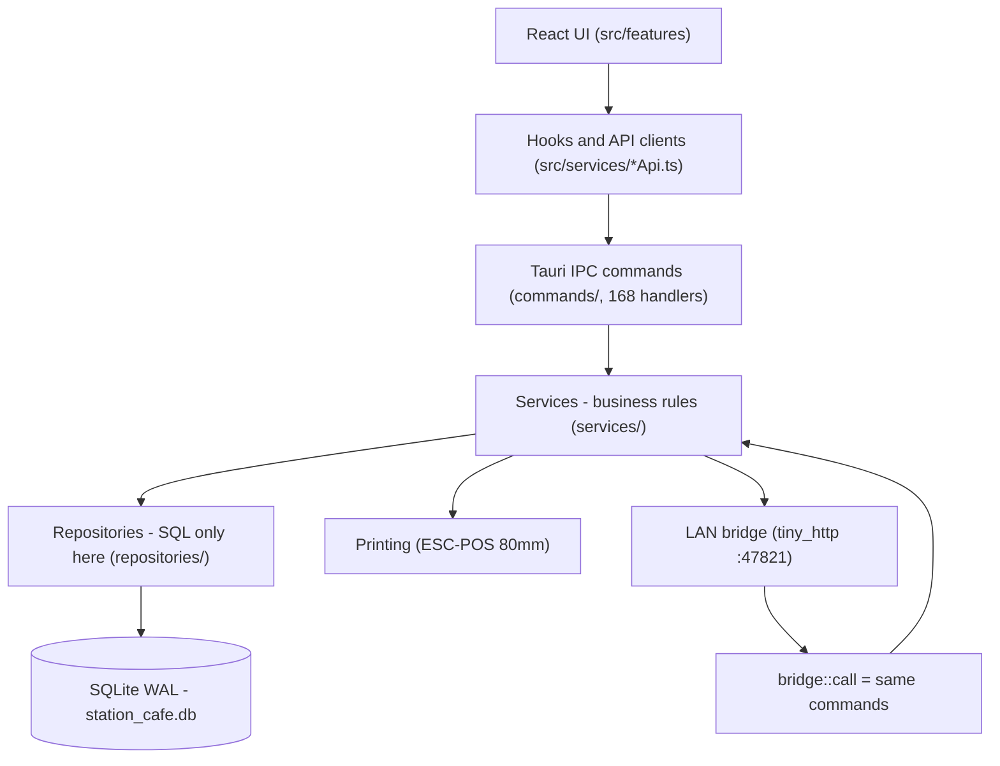

# Station Cafe & Wash Cars — ستايشن كافيه

> Production-grade, **100% offline-first** desktop POS & business-management system for a combined cafe + car wash.
> This README is the authoritative handoff document for the receiving engineering team. Every claim is grounded in the audited implementation (sources cited per section).

**Stack:** Tauri 2 (Rust) · React 19 · TypeScript · SQLite (`rusqlite`, bundled) · Tailwind CSS v4 · shadcn/ui · i18next (Arabic/RTL-first)

**Version at handoff:** `0.1.0` (consistent across `package.json`, `src-tauri/Cargo.toml`, `src-tauri/tauri.conf.json` — enforced by `pnpm version:check`). Branch `main`, remote `origin` (`github.com/bassim-ghaly-14/station-cafe`).

---

## Table of contents

1. [Product overview](#1-product-overview)
2. [Business problems solved](#2-business-problems-solved)
3. [Feature inventory](#3-feature-inventory)
4. [Architecture overview](#4-architecture-overview)
5. [Technology stack](#5-technology-stack)
6. [Repository structure](#6-repository-structure)
7. [Domain model & terminology](#7-domain-model--terminology)
8. [Business rules — orders, checkout, wash](#8-business-rules--orders-checkout-wash)
9. [Authentication, roles & permissions](#9-authentication-roles--permissions)
10. [Money, pricing, inventory & units](#10-money-pricing-inventory--units)
11. [Shifts, business days & reporting](#11-shifts-business-days--reporting)
12. [Database design & migrations](#12-database-design--migrations)
13. [LAN printing & hardware integration](#13-lan-printing--hardware-integration)
14. [Localization, RTL, theming & accessibility](#14-localization-rtl-theming--accessibility)
15. [Updater & release lifecycle](#15-updater--release-lifecycle)
16. [Development prerequisites](#16-development-prerequisites)
17. [Installation & local development](#17-installation--local-development)
18. [Configuration](#18-configuration)
19. [Scripts reference](#19-scripts-reference)
20. [Testing, linting & verification](#20-testing-linting--verification)
21. [Packaging & release procedure](#21-packaging--release-procedure)
22. [Backup, recovery, troubleshooting & operations](#22-backup-recovery-troubleshooting--operations)
23. [Security boundaries](#23-security-boundaries)
24. [Known limitations & unimplemented items](#24-known-limitations--unimplemented-items)
25. [Architectural decisions & lessons learned](#25-architectural-decisions--lessons-learned)
26. [Maintenance guide & extension points](#26-maintenance-guide--extension-points)
27. [Final handoff checklist](#27-final-handoff-checklist)
28. [Supporting documents](#28-supporting-documents)

---

## 1. Product overview

Station Cafe is a single-machine desktop application for a cafe that also operates a car wash on the same premises. One till runs the whole business: dine-in tables, takeaway counter, wash bay, cashier shifts, expenses, staff, customers/cars, inventory, raw materials, reports, Arabic receipts, and manager access from phones on the cafe Wi-Fi.

**Intended users:**

| User                                  | What they do in the app                                                                                                               |
| ------------------------------------- | ------------------------------------------------------------------------------------------------------------------------------------- |
| Cashier (`STAFF`)                     | Opens/closes tables, takes orders, takes payments, issues wash tickets, punches attendance                                            |
| Manager (`MANAGER`)                   | Everything a cashier does, plus closes shifts/days, manages catalog/prices, expenses, staff, customers, settings, LAN access, updates |
| Admin (`ADMIN`, developer/owner)      | Everything a manager does, plus table-count configuration, developer danger-zone operations                                           |
| Wash worker (`WASH_WORKER`, no login) | Named on wash jobs for operational attribution; punched in by any signed-in user; never signs in                                      |

The production language is **Arabic (Egypt)**, RTL-first. The UI, receipts, and closing documents are Arabic. Evidence: `src/locales/ar/translations.json` (28 top-level namespaces, ~2200 lines), `src/lib/i18n.ts`, Arabic-first print templates in `src-tauri/src/printing/templates/`.

## 2. Business problems solved

- **One till, two businesses:** cafe lines and wash lines can live on the _same order_, yet revenue is still reported per department via per-line `department` sums. Evidence: `services/checkout.rs` `cafe_total`/`wash_total`; `services/reconciliation.rs` `AreaBreakdown`.
- **Cash-drawer truth:** every shift reconciles `expected = opening + cash in − cash out` against cash handed over, classified Balanced/Shortage/Surplus. Card/credit never enter the drawer formula. Evidence: `services/reconciliation.rs`.
- **No floating-point money:** all financial values are `i64` piasters; rates are fixed-point x100000 with half-up rounding. Evidence: `src-tauri/src/money.rs`.
- **Offline-first:** no internet or cloud. The SQLite file in the OS app-data dir is the system of record. Evidence: `db.rs` (`station_cafe.db`), `network/server.rs`.
- **Immutable history:** invoices snapshot prices, discounts, service charge, customer/car data at checkout. Evidence: `repositories/invoices.rs`, `services/checkout.rs`.
- **Shift-aware accounting:** figures are scoped by `shift_id`, never by date alone. Evidence: `services/pos.rs`, `repositories/shifts.rs`.

## 3. Feature inventory

Verified in `src-tauri/src/commands/` (12 files, 168 handlers) and `src/features/` (12 folders: auth, catalog, customers, dev, employees, expenses, inventory, pos, printing, qr, reports, sales).

| Domain               | Implemented behavior                                                                                                                                                                                                  |
| -------------------- | --------------------------------------------------------------------------------------------------------------------------------------------------------------------------------------------------------------------- |
| POS / tables         | Grid EMPTY/OPEN/OCCUPIED/READY_TO_PAY; explicit open, start-order, checkout or close-empty; product browser; POS calculator; takeaway orders with per-day numbers                                                     |
| Checkout             | CASH (received/change), CARD, CREDIT (allow-listed only); order discount (open amount + shared 4-digit PIN); service charge (fixed picks + custom); `total = subtotal - discount + service`; single-transaction close |
| Wash                 | Wash services on any order; per-day `waiting_no`; wash-ticket document; STAFF cannot discard an order once a ticket exists                                                                                            |
| Shifts & days        | Open day (MANAGER+); open/close shift with opening cash; live hydrated totals; expected/actual reconciliation; manager recovery close; day close aggregating shifts                                                   |
| Invoices & documents | Cafe/wash/hybrid invoices, takeaway receipt, current-order slip, shift & day reports, test page; preview renders the same template read-only                                                                          |
| Customers & cars     | CRUD, plate-indexed cars, phone/name/plate search, credit accounts + settlement, phone export                                                                                                                         |
| Employees & payroll  | Roster (CASHIER/WASH_WORKER), attendance punch by anyone + MANAGER+ corrections, advances, deductions, payroll runs with snapshot net                                                                                 |
| Expenses             | Manual expenses with categories, daily/monthly charts, shift- and day-scoping                                                                                                                                         |
| Inventory            | Finished-product tracking + low-stock notifications; raw materials (purchase/stock/waste, archive/restore); per-product recipes; atomic checkout consumption                                                          |
| Catalog              | Products & wash services (CAFE/WASH), system + custom categories, active/inactive visibility, seed-flagged rows                                                                                                       |
| Reports & analytics  | Sales/expense/customer/employee analytics, monthly executive report, daily bars, cafe-vs-wash, monthly comparison, Excel export                                                                                       |
| Printing             | Target config (`file:`/`share:`/queue), CP1256/LATIN Arabic, configurable codepage, logo toggle, 60s duplicate guard, `print_jobs` trail                                                                              |
| LAN manager access   | Optional HTTP listener (default 47821): health/login/me/summary + `/api/v1/cmd/*` bridge; mDNS `station.local`; QR; login rate limiter                                                                                |
| Settings             | Service-charge list, discount picks + PIN, credit rules, revenue targets + overrides, table count (ADMIN), display formatting, local access, updates                                                                  |
| Updater              | Signed in-app updates from GitHub Releases (Windows NSIS + universal macOS), manual-only, blocked during open shift/day, Arabic dialog                                                                                |

## 4. Architecture overview

Verified from `src-tauri/src/lib.rs`, `docs/ARCHITECTURE.md`, and module headers:



| Layer               | Owns                                            | Never does                         |
| ------------------- | ----------------------------------------------- | ---------------------------------- |
| React UI            | Presentation, RTL layout, display formatting    | SQL, printer bytes, auth decisions |
| Hooks / API clients | Typed IPC transport (identical over LAN bridge) | Business rules                     |
| Tauri commands      | Session resolution, thin delegation             | SQL, calculations                  |

## 5. Technology stack

| Technology                      | Role in this app                                                                     | Evidence                                                           |
| ------------------------------- | ------------------------------------------------------------------------------------ | ------------------------------------------------------------------ |
| Tauri 2                         | Desktop shell, IPC boundary, updater + process plugins                               | `src-tauri/tauri.conf.json`, `lib.rs` plugin registration          |
| Rust (`rusqlite` bundled)       | All business logic, SQL, printing, LAN server                                        | `src-tauri/src/` (~94k lines incl. tests)                          |
| React 19 + TypeScript           | Entire UI                                                                            | `src/features/`, `src/components/`                                 |
| SQLite (WAL)                    | System of record, single `Mutex<Connection>`                                         | `db.rs`: `journal_mode=WAL`, `synchronous=FULL`, `foreign_keys=ON` |
| Tailwind v4 + shadcn/ui         | Styling + primitives; color tokens in one file                                       | `src/styles/colors.css`, `src/components/ui/`                      |
| i18next, `ar-EG`                | Arabic production locale, RTL-first                                                  | `src/locales/ar/translations.json`, `src/lib/i18n.ts`              |
| `tiny_http`                     | Blocking LAN HTTP server matching the sync `Mutex<Connection>` model (no Tokio/Axum) | `Cargo.toml` comment, `network/server.rs`                          |
| `mdns-sd` (no default features) | `station.local` advertisement on the bound interface only                            | `Cargo.toml` comment, `network/mdns.rs`                            |
| `qrcode` (Rust)                 | QR encodes the bare address next to the code that knows the port/IP                  | `Cargo.toml` comment, `network/qr.rs`                              |
| `local-ip-address`              | Real LAN interface address (never hardcoded)                                         | `network/address.rs`                                               |
| Argon2id                        | Password + discount-PIN hashing (PHC strings)                                        | `services/auth.rs`, `services/settings.rs`                         |
| `chrono-tz` (`Africa/Cairo`)    | Business timezone honoring Egypt DST                                                 | `time.rs` `BUSINESS_TZ`                                            |
| recharts, xlsx-js-style         | Charts + Excel export                                                                | `src/components/charts/`, `src/features/reports/charts/`           |
| Vitest + Testing Library        | 111 files / 1733 frontend tests                                                      | `vite.config.ts`, `src/test/setup.ts`                              |
| `cargo test` (in-memory SQLite) | Backend tests incl. DB                                                               | `pos_rules_test.rs`, `reconciliation_test.rs`, etc.                |
| oxlint + Prettier               | Lint + format                                                                        | `package.json` scripts                                             |
| pnpm 11                         | Package manager                                                                      | `package.json`, CI workflow                                        |
| GitHub Actions + tauri-action   | Windows + macOS builds, merged manifest, manifest gate                               | `.github/workflows/windows-build.yml`                              |

## 6. Repository structure

```text
src/                       # React frontend
  app/                     # shell, router, navigation (single NAV source of truth)
  features/                # one folder per business domain (12)
  components/ui|branding|charts|qr|states/
  lib/                     # money, formatting, roles, i18n, errors, theme
  locales/ar/              # production translations (translations.json)
  services/                # typed IPC clients (*Api.ts) + ipc.ts transport
  styles/colors.css        # COLOR SOURCE OF TRUTH (light+dark tokens)
src-tauri/                 # Rust backend
  src/
    lib.rs / main.rs       # state (AppState), 168-command registration
    commands/              # 12 thin IPC modules (auth..status)
    services/              # 15 business-rule modules (transactions live here)
    repositories/          # 15 SQL-only modules
    db.rs                  # connection, pragmas, 39 numbered migrations (embedded)
    money.rs / time.rs / error.rs / normalize.rs
    seed.rs                # OFFICIAL dataset only (never demo rows)
    demo_data.rs           # DEMO dataset only (developer action)
    printing/              # ESC/POS encoder + IR + 8 templates + backends
    network/               # config/server/api/bridge/web/mdns/qr/address/runtime
    *_test.rs              # backend suites (pos_rules, reconciliation, workflow...)
  capabilities/default.json # least-privilege updater+restart permissions
  tauri.conf.json          # product config, CSP, updater pubkey + endpoint
scripts/                   # check-version, verify-release-manifest, i18n-callers, audit-public-metadata
docs/                      # ARCHITECTURE, DECISIONS, IMPLEMENTATION_PLAN, RELEASING

## 7. Domain model & terminology

| Term | Verified meaning | Source |
| ---- | ---------------- | ------ |
| CAFE / WASH (product `department`) | Which side of the business a product/service belongs to; a line's department drives revenue splits | `services/checkout.rs` line sums; migration 14 catalog rebuild |
| TABLE / TAKEAWAY (`order_type`) | TABLE orders attach to a `cafe_tables` row + session; TAKEAWAY orders have no table and take a per-day `takeaway_no` at checkout | `repositories/pos.rs` `Order`, `services/pos.rs` `start_takeaway`, `services/checkout.rs` |
| HYBRID (invoice classification) | NOT an order type. An invoice containing both CAFE and WASH lines. Counts are exclusive (`cafe+wash+hybrid == invoices_count`); money sums contribute to both departments | `services/reconciliation.rs` `AreaBreakdown`; migration 26 shift columns |
| READY_TO_PAY | Legacy lifecycle state still accepted at checkout alongside OPEN; no payment-request prerequisite exists | `services/checkout.rs` validation comment |
| `users.role` vs `employees.employee_type` | Role (ADMIN/MANAGER/STAFF) is the authority in `users`; type (CASHIER/WASH_WORKER) is the HR job in `employees`. A CASHIER may hold any role; a WASH_WORKER has no login (DB CHECK) | `services/employees.rs` header, `src/lib/roles.ts` |
| Business day vs shift | A day (`business_days` OPEN/CLOSED) aggregates 1..N shifts (`shifts`); totals scope by `shift_id`, days by included-shift lists | `services/shifts.rs`, `repositories/shifts.rs` |
| `station_now()` / `station_today()` | Canonical SQL clock functions registered per connection; business date derives in Rust from `Africa/Cairo` | `db.rs` `register_clock`, `time.rs` |
| Seed vs demo | `seed.rs` = official baseline only; `demo_data.rs` = sample data only, reachable solely via developer Load Demo Data | module headers |
| `NO_CUSTOMER_LABEL` | Stored canonical Arabic identity for invoices without a customer, not a display fallback | `services/checkout.rs` |

tests/                     # build-output inspection suite (runs on dist/)
.github/workflows/         # windows-build.yml (release pipeline)
```

Generated/never-committed: `node_modules/`, `dist/`, `src-tauri/target/`, `*.db*`, `*.log`, `*.pdf`/`*.xlsx` (see `.gitignore`).

| Services | Validation, authorization, transactions, calculations | SQL strings |
| Repositories | All SQL, row mapping | Business decisions |

## 8. Business rules — orders, checkout, wash

Order lifecycle (`services/pos.rs`): `EMPTY --open_table--> OPEN(session) --start_order--> OCCUPIED(order) --checkout--> EMPTY`, or `OPEN --close_empty_table--> EMPTY` (no invoice, no revenue). Clicking a table card never mutates state. Every creating action gates on OPEN business day + caller's own ACTIVE shift (`require_day_and_shift`); tables and orders carry both `business_day_id` and `shift_id` so shift totals stay correct.

Checkout (`services/checkout.rs`) runs in ONE SQLite transaction: validate (payable status OPEN/READY_TO_PAY, non-empty, discount auth, service-charge rule, method rules incl. CASH received>=total and CREDIT allow-list) → calculate (`total = subtotal - discount + service`) → persist invoice + line snapshot → payment row → credit account (CREDIT) → close order + free table → decrement tracked product stock → consume recipe materials (all-or-nothing) → audit. Any failure rolls everything back.

Discounts: any positive order discount requires the ONE global shared 4-digit PIN (Argon2id in `app_settings`), authorized via `settings::authorize_discount`; a discount already persisted on the order is not re-challenged, a changed amount is. Zero/clearing needs no PIN. There is no ceiling beyond `amount <= subtotal`. Service charge is independent and never needs a PIN (`settings::resolve_service_charge` — one function used by preview, checkout, and print).

Wash: `issue_wash_ticket` allocates the per-day `waiting_no` (`MAX+1` within the day) inside a transaction; `wash_ticket_snapshot` is the read-only twin. STAFF cannot discard an order once a ticket exists (checked against `wash_tickets`, not the lines, so removing lines cannot bypass it). The invoice snapshots `wash_employee_id`; wash revenue is never attributed to a person (ARCHITECTURE.md section 7).

Evidence: `services/pos.rs`, `services/checkout.rs`, `services/settings.rs`, `repositories/pos.rs`, `repositories/invoices.rs`, `pos_rules_test.rs`, `wash_tickets_test.rs`, `table_lifecycle_test.rs`, `workflow_test.rs`.

| SQLite | Durable truth (WAL, synchronous=FULL, foreign_keys=ON) | Anything else |

## 9. Authentication, roles & permissions

Three login roles, weakest to strongest: STAFF < MANAGER < ADMIN (`services/auth.rs` `ROLES`). Passwords are Argon2id PHC strings; login credentials are 4-5 digit PINs validated for shape before lookup (uniform `auth.bad_credentials`, no account probing); suspended users and INACTIVE employees are refused; sessions are 192-bit random tokens with only the SHA-256 hash stored, TTL 14h (one business day).

Authorization is enforced in services via `require_role`, re-checked at the command boundary — UI hiding is never the boundary. Verified gates: table count ADMIN (`services/pos.rs`); open/close day MANAGER+; manager recovery close MANAGER+; catalog, settings, network config, revenue targets MANAGER+; employee corrections, advances, payroll MANAGER+ (attendance punch itself is open to any authenticated user); financial payloads are role-projected server-side (cashiers receive attendance-operation rows without salaries).

Employee types (`services/employees.rs`, `src/lib/roles.ts`): CASHIER = has a login (whose `users.role` is the authority); WASH_WORKER = no login at all (DB CHECK). The employees table presents the login's role, or WASH_WORKER when there is none. Login cards list exactly the accounts that may sign in (verified by test).

Evidence: `services/auth.rs` (+ embedded tests), `commands/common.rs` `authorized`, `repositories/users.rs`, `dev_settings_roles_test.rs`, `src/app/navigation.ts` (UI convenience only).

## 10. Money, pricing, inventory & units

Money (`money.rs`): `Money = i64` piasters, `MINOR_PER_MAJOR = 100`; `Rate` fixed-point x100000; `percent_of`/`div_round` half-up; discounts floored at 0. Example: 10 kg purchased for EGP 300 total normalizes to 10 000 g at 3 piasters/g display — i.e. EGP 30/kg and EGP 0.03/g — because cost is entered as the purchase TOTAL and quantity normalizes to base units by integer factor (1000). Display (`src/lib/money.ts` `formatMinorMoney` / `formatMoney`, `ج.م` label, compact/full variants, Dev Settings preview) never mutates stored values; print (`format_minor_for_print`) keeps fixed-width columns with two-decimal precision and no grouping.

Raw materials (`services/recipes.rs`): base units GRAM or MILLILITER only; purchase units GRAM/MILLILITER (x1) and KILOGRAM/LITER (x1000) — the single conversion point; family mismatch refused; purchase is atomic (stock + movement + expense); `last_purchase_unit_cost_minor` is display-only for recipe costing, never rewrites history. Checkout consumes per recipe by stable `product_id`, aggregated across lines, validated for every material BEFORE any mutation, inside the checkout transaction — a shortage rolls the whole sale back. Products without recipes are unaffected. Finished-product stock decrements in the same transaction (`services/ops.rs`).

Prices: current catalog prices are operational; history lives in invoice line snapshots, so price edits never alter closed documents. Revenue targets resolve per month/department as override-else-current-default (`resolve_monthly_target`).

Evidence: `money.rs`, `services/recipes.rs`, `services/settings.rs`, `repositories/recipes.rs`, `src/lib/money.ts`, `src/lib/formatting.ts`, `recipes_test.rs`.

Cross-cutting: errors travel as stable `{kind, message, code}` keys mapped to Arabic in UI (`error.rs`, `src/lib/err.ts`); time flows from one module (`time.rs`, `Africa/Cairo`, explicit `...Z` UTC instants); money flows from one module (`money.rs`, integer piasters). The network module contains no SQL and no business logic by documented policy (`network/mod.rs`).

## 11. Shifts, business days & reporting

Lifecycle (`services/shifts.rs`): day NOT_OPEN/OPEN/CLOSED; shift ACTIVE/CLOSING/CLOSED. Open day MANAGER+ (one open day at a time); open shift requires an open day and no other ACTIVE shift globally (one-open-shift rule); POS header reads `my_shift` (caller's, live-hydrated) + `open_shift` (whoever's, same `any_active_shift` read that enforces the rule). Closing a shift persists the immutable snapshot (`compute_shift_totals`), claims its expenses, and audits; a MANAGER+ may recovery-close another user's abandoned shift. Day close aggregates INCLUDED shifts' snapshots into an immutable day row + `day_closing_shifts` membership, claims unassigned day expenses once, then closes the day. A zero-activity day with no open shift is a real all-zero closing (otherwise the day could never advance); with an open shift still present it is blocked.

Why `shift_id`, not date: a date can hold several shifts, so date-scoped sums mix shifts. Every lifecycle counter, KPI, and closing figure scopes by `shift_id` (`shift_lifecycle_counts`, `hydrate_active_totals`); day figures read included-shift snapshots, never live rows. Table-session closes are dated by their own `closed_at` instant, not the opening day.

Reconciliation (`services/reconciliation.rs`): the single drawer formula `expected = opening + CASH in - CASH out` (card/credit excluded); `CashStatus` Balanced/Shortage/Surplus from the signed difference; area counts exclusive, area money overlapping for hybrids. Reports distinguish stored records (invoices, payments, snapshots) from computed aggregates with explicit shift/day filters (`services/reports.rs`, `services/sales.rs`, `repositories/analytics.rs`, `sales_analytics.rs`).

Payroll (`repositories/employee_analytics.rs`, `services/employees.rs`): base salary + attendance-derived presence; advances (direct ledger or expense-linked, RECORDED/REVERSED — reversed keeps its amount); deductions in the open month; payroll runs snapshot the net via `compute_net`. Absence is never inferred from a missing row.

## 12. Database design & migrations

SQLite file `station_cafe.db` in the OS app-data dir; `WAL` + `synchronous=FULL` + `foreign_keys=ON`; single `Mutex<Connection>` shared by commands and the LAN thread. Canonical clock (`station_now()`, `station_today()`, `station_business_date(x)`) registered per connection before migrations run.

Migrations: 39 numbered embedded SQL migrations in `db.rs`, applied transactionally and tracked in `_migrations`. Policy: never edit an applied migration — add a new one. Authoritative schema lives ONLY in `db.rs`; there is no `.sql` file or `migrations/` directory.

Key tables (33): `app_settings` (JSON config), `business_days`, `shifts` (+ `day_closings`, `day_closing_shifts`), `users`, `sessions` (hashed tokens), `employees`, `attendance_days`, `employee_advances`, `employee_deductions`, `payroll_runs`, `customers`, `cars`, `categories`, `products`, `inventory_items`, `stock_movements`, `inventory_notifications`, `raw_materials`, `raw_material_movements`, `product_recipe_items`, `cafe_tables`, `table_sessions`, `orders`, `order_lines`, `wash_tickets`, `invoices`, `invoice_lines`, `invoice_customers`, `payments`, `credit_accounts`, `credit_payments`, `expenses`, `print_jobs`, `audit_log`. Per-domain SQL lives in `repositories/`.

Integrity: FKs ON; partial unique index for one OPEN session per table; CHECKs for employee-type/login consistency and invoice states (`PAID`/`PARTIALLY_PAID`/`CREDIT` — cancelled removed by migration 32); archival is soft — history rows are never deleted by business flows; developer clear/seed is the only destructive path (ADMIN-gated, one-time grant).

Evidence: `services/shifts.rs`, `repositories/shifts.rs`, `services/reconciliation.rs`, `manager_close_test.rs`, `reconciliation_test.rs`, `monthly_executive_test.rs`, `employee_financials_test.rs`, `attendance_override_test.rs`.

## 13. LAN printing & hardware integration

Printing (`printing/`): single service — resolve config, render template, duplicate guard, backend send, record job. ESC/POS for 80 mm Xprinter: 42-column RTL lines, bidi visual-order reversal, CP1256 (or LATIN) with configurable codepage per model, monochrome logo abstraction. Windows transport is a RAW spool job via `windows-sys` (target-gated; macOS builds pull nothing in). Target: `file:/path`, `share:QueueName`, or bare queue name; default `none`. Duplicate guard: SHA-256 of bytes vs `print_jobs` within 60 s (0 disables). Failures surface as stable `printer.*` keys. Templates (8): cafe/wash/hybrid invoice, takeaway receipt, current order, wash ticket, shift closing, day report, test page. Preview runs the identical template path read-only.

LAN (`network/`, default port 47821, off by default): one `tiny_http` listener serves `GET /health`, `POST /auth/login` (rate-limited), `GET /me`, `GET /manager/summary`, plus `/api/v1/cmd/*` bridge invoking the REAL commands with the bearer token (same login, same role gates; same error shape so `ipc.ts` behaves identically), plus the embedded React bundle with SPA fallback. Bodies capped at 8 KiB; raw DB/IO text never crosses the boundary. Config in `app_settings["network"]` (MANAGER+; wildcard/loopback binds and ports <1024 refused; corrupt value fails safe to disabled). Discovery: `mdns-sd` advertises `station.local` pinned to the bound interface (link-local, never leaves the LAN). QR encodes the bare address only — no tokens. Bind failure is reported, never fatal.

Evidence: `printing/*`, `network/*`, `network_lan_http_test.rs`, `network_test.rs`, `src/services/ipc.ts`.

## 14. Localization, RTL, theming & accessibility

Arabic (Egypt) is the production locale: `src/locales/ar/translations.json` (28 namespaces, ~2200 lines) via i18next (`src/lib/i18n.ts`); backend and LAN error keys map to Arabic client-side (`src/lib/i18n-errors.ts`, interpolation tests). RTL is first-class: direction-aware layouts, RTL two-column receipts, centralized currency/number formatting (`src/lib/formatting.ts` + `src/lib/money.ts`: `ج.م` label position, decimals, grouping, compact thresholds). Themes: light/dark via semantic tokens — `src/styles/colors.css` is the COLOR SOURCE OF TRUTH, consumed via Tailwind classes, never hardcoded. Responsive: desktop sidebar + mobile bottom bar + More sheet render from the single `NAV` list (`src/app/navigation.ts`); primary tabs are STAFF-reachable only. POS extras: floating/pinned calculator with history, LocalAccess QR card, thermal-receipt preview scaled to paper width. Accessibility: icon+text+color table states (never color alone), dialog focus/overlay handling, toast + skeleton + empty/error states.

## 15. Updater & release lifecycle

`tauri-plugin-updater` + GitHub Releases, Windows and macOS from the same Release at the same version. Manifest endpoint compiled in: `https://github.com/bassim-ghaly-14/station-cafe/releases/latest/download/latest.json` with the minisign pubkey in `tauri.conf.json`. One Release holds: Windows x64 NSIS `.exe` (+ `.sig`), universal macOS `.app.tar.gz` (+ `.sig`, serving both architectures via two manifest keys), and the merged `latest.json`. The client never picks a platform. Flow is manual-only from the Application Updates card; no startup check, polling, or background download. Updates are blocked during an open shift or business day. Signing: updater minisign key (private = `TAURI_SIGNING_PRIVATE_KEY` CI secret only; password must be ABSENT) vs Windows Authenticode (separate install-time mechanism). Capabilities are least-privilege: `updater:allow-check` + `updater:allow-download-and-install` + `process:allow-restart` only. Version lockstep (`package.json` == `Cargo.toml` == `tauri.conf.json`, tag `v<version>`) is enforced by `check-version.mjs`. Full procedure: `docs/RELEASING.md`.

## 16. Development prerequisites

- Node 24 + pnpm 11; Rust stable (MSRV 1.77.2 per `Cargo.toml`).
- macOS for daily dev; Windows/macOS artifacts come from CI — no extra machines needed.
- No external services or databases. The app creates `station_cafe.db` in the OS app-data dir on first run and self-migrates.
- Optional: Xprinter 80 mm printer on Windows for physical tests (`file:` target + preview cover the rest); a second device on the same Wi-Fi for LAN tests; CI secrets only for releases.

## 17. Installation & local development

```bash
pnpm install        # install frontend dependencies
pnpm dev            # frontend only (Vite, http://localhost:5173, fixed port)
pnpm dev:app        # full Tauri app (runs pnpm dev + Tauri shell; needs Rust)
pnpm build          # tsc -b + vite build -> dist/ (also the LAN-served bundle)
pnpm build:app      # production desktop bundle (NSIS/.app per host OS)
pnpm preview        # serve the built dist/ locally
```

First run: open the app, sign in with a seeded account (see `seed.rs` / Dev Settings), open a business day (MANAGER+), open a shift, then the POS unlocks. Without an open day + active shift, tables and orders are gated — this is the backend rule, not an empty state.

## 18. Configuration

No `.env` file contract exists in this repo (`.gitignore` ignores `.env*`, but no code reads one — verified by search). All runtime configuration lives in the `app_settings` JSON store, edited in-app:

| Key                                                           | Meaning                                                     | Who may change                   |
| ------------------------------------------------------------- | ----------------------------------------------------------- | -------------------------------- |
| `printer`                                                     | Print target, Arabic mode, codepage, logo, duplicate window | Manager via Printer Settings UI  |
| `network`                                                     | LAN listener enabled/bind/port                              | MANAGER+                         |
| `service_charge`                                              | Ordered fixed service-charge picks                          | MANAGER+                         |
| `credit`                                                      | Credit enablement + allow-list                              | MANAGER+                         |
| `discount_authorization_hash`                                 | Argon2id of the shared 4-digit discount PIN                 | MANAGER+                         |
| `discount_limit` / quick picks                                | Discount shortcuts (shortcuts, not ceilings)                | MANAGER+                         |
| `revenue_target_*`                                            | Cafe/wash defaults + per-month overrides                    | MANAGER+                         |
| display formatting, chart colors, sales period, work duration | UI preferences                                              | MANAGER+ (sections allow-listed) |

Example values only (never secrets): `{"enabled": false, "bind": "lan", "port": 47821}` for `network`; `{"amounts": [500, 1000]}` (piasters) for `service_charge`. Print target examples: `"none"`, `"file:/tmp/print.bin"`, `"share:Xprinter"`.

## 19. Scripts reference

Exact behavior from `package.json`:

| Command                        | What it does                                                                |
| ------------------------------ | --------------------------------------------------------------------------- |
| `pnpm dev`                     | Vite dev server only                                                        |
| `pnpm build`                   | `tsc -b && vite build`                                                      |
| `pnpm lint`                    | `oxlint` (0 warnings/errors at handoff)                                     |
| `pnpm preview` / `pnpm tauri`  | Serve dist / Tauri CLI passthrough                                          |
| `pnpm dev:app`                 | `tauri dev` (full app)                                                      |
| `pnpm build:app`               | `tauri build` (local bundle)                                                |
| `pnpm test` / `test:watch`     | `vitest run` / watch (111 files, 1733 tests at handoff)                     |
| `pnpm i18n:audit`              | `scripts/i18n-callers.mjs` — translation-key usage audit                    |
| `pnpm release:verify`          | `scripts/verify-release-manifest.mjs` — read-only manifest gate             |
| `pnpm format` / `format:check` | Prettier write / check                                                      |
| `pnpm version:check`           | `scripts/check-version.mjs` — triple-version lockstep (never writes)        |
| `pnpm typecheck`               | `tsc -b --noEmit`                                                           |
| `pnpm check`                   | build + typecheck + lint + format:check + i18n:audit + version:check + test |

## 20. Testing, linting & verification

- Frontend: `pnpm test` (Vitest + jsdom, setup in `src/test/setup.ts`; suites live beside sources as `*.test.ts(x)`; `tests/` inspects the built `dist/`). Covers POS access rules, discounts, money formatting, charts, navigation gates, IPC transport parity, release integrity (CSP hash-pin, capability set, no-platform-branch), and more.
- Backend: `cargo test` from `src-tauri/` (in-memory SQLite; suites: `pos_rules`, `reconciliation`, `workflow`, `table_lifecycle`, `wash_tickets`, `recipes`, `sales_analytics`, `monthly_executive`, `manager_close`, `employee_financials`, `attendance_override`, `network*`, `deletion`, `invoice_identity`, `dev_settings_roles`, `expense_categories`, `revenue_targets`, `customer_analytics`, `offline_verify`).
- Quality gates: `pnpm typecheck`, `pnpm lint` (oxlint), `pnpm format:check` (Prettier), `pnpm i18n:audit`, `pnpm version:check`. Run the full gate with `pnpm check`.
- Printing without hardware: set target to `file:/path` and inspect bytes, or use preview commands / `ThermalReceipt` preview. LAN without a phone: `GET /health`, login throttle tests, and the `network_*` suites.
- Demo data for repeatable manual testing: developer Load Demo Data builds 24 months of consistent history through the real services (deterministic seed) and leaves today open with one ACTIVE shift plus open table orders. Load Official Data produces the production baseline only — never demo rows.

## 21. Packaging & release procedure

Local bundle: `pnpm build:app` (Tauri build for the host OS). Production releases come ONLY from CI (`.github/workflows/windows-build.yml`):

```bash
# 1. set the SAME version in package.json, Cargo.toml, tauri.conf.json
pnpm version:check              # must pass before you tag
# 2. commit + tag (tag MUST be v<version>)
git commit -am \"release: v0.1.1\"
git tag v0.1.1 && git push origin main --tags
```

CI order: `build-windows` (NSIS `.exe` + `.sig`, Windows half of `latest.json`) → `build-macos` (universal `.app` + `.tar.gz` + `.sig` + `.dmg`, merged macOS keys; serial merge — parallel jobs would race the manifest) → `verify-release` (downloads the published `latest.json`, fails unless Windows x64 + both Mac archs resolve to signed artifacts). Pushes to `main` build-and-verify only as a draft prerelease; only a `v*` tag publishes. Watch for `release manifest ok:` in the third job — without it the release is NOT updatable everywhere. Then delete any stale MSI asset from the Release page manually (updater is NSIS-only). Details: `docs/RELEASING.md`.

## 22. Backup, recovery, troubleshooting & operations

- **Backup:** copy `station_cafe.db` (plus `-wal`/`-shm` if present — or close the app first) from the OS app-data dir while the app is closed. No in-app backup scheduler exists (IMPLEMENTATION_PLAN 1.10/Phase-2-8 describe the planned job, not an implemented one). Keep versioned copies; losing the updater private key (CI secret, outside the repo) permanently breaks future updates — back it up separately.
- **Recovery:** restore the file to the same path and relaunch; migrations re-apply forward automatically. Historical invoices are snapshots, so a restore is point-in-time consistent.
- **POS locked (no tables/orders):** open a business day (MANAGER+), then open a shift — the gate is backend-enforced (`pos.no_business_day` / `pos.no_active_shift`).
- **Day cannot close:** close the still-open shift first; a zero-activity day closes as an all-zero record only when no shift is open.
- **Cash mismatch:** the closing document classifies shortage vs surplus from `actual - expected`; card/credit are correctly absent from the drawer math.
- **Printer errors:** stable `printer.*` keys in UI; check target/mode/codepage in Printer Settings; use `print_test` and `file:` capture; duplicate suppression may hide an immediate reprint (60 s window, `force` bypasses).
- **LAN unreachable:** confirm `network.enabled`, port (default 47821), same Wi-Fi, and that the bind is the LAN interface; `station.local` is mDNS-only (no DNS/router config will fix a non-mDNS client — use the QR/IP address); bind failures are reported in-app while the POS keeps working.
- **Update invisible:** confirm the tag is `v<version>` matching all three version files, the Release holds all platform artifacts, and `verify-release` logged `release manifest ok:`.
- **Lockout:** the developer reset recreates the starter account under official credentials; non-seed starter rows have their credentials reconciled at seed time (`seed.rs`).

## 23. Security boundaries

- Authorization lives in Rust services (`require_role` + command re-check); the UI role filter (`navigation.ts`, `devSectionAccess.ts`) is convenience only and proven so by tests that invoke commands directly.
- Passwords AND the discount PIN are Argon2id hashes; sessions store token hashes only; the LAN bearer token travels in the `Authorization` header, never URL/body/QR.
- The LAN module has no SQL and no business logic; every bridge call runs the same command, same auth, same rules as the desktop. Request bodies are capped (8 KiB), login is rate-limited, errors cross as opaque stable codes (rusqlite/IO text never leaves the machine).
- `0.0.0.0`/loopback binds are refused; the listener is off by default; corrupt config fails safe to off. mDNS is link-local advertisement only — no authentication or encryption is claimed for the LAN surface.
- Secrets: the updater private key, Apple credentials, and any passwords exist ONLY as CI secrets or in the local DB — never in the repo, logs, audits, invoices, or this document. The compiled-in updater pubkey is public by design.
- Sensitive-data handling: role-projected payloads (cashiers never receive salaries/financial aggregates); audit log records actor, action, entity, before/after for sensitive operations; invoice customer data is a business snapshot, not a leak vector — treat DB copies and exports as sensitive.

## 24. Known limitations & unimplemented items

Explicitly NOT implemented (documented as planned in `docs/IMPLEMENTATION_PLAN.md`, not described as features): yearly archive to a separate read-only DB; automated/scheduled backup + restore UX; recurring expenses; email reports; cloud sync or multi-machine database sharing (the LAN shares the app, never the SQLite file). Release prerequisites requiring humans/secrets: updater private key, Apple signing (optional), GitHub Release publication, stale-MSI deletion. Hardware-dependent and unverified at handoff: physical Xprinter output on the cafe's exact model (codepage may need adjusting), real-phone mDNS/QR reachability on the cafe Wi-Fi, production signed-update round-trip against a live Release. `dist/` and `station-cafe-vs-wash-monthly.xlsx` at the repo root are build/data artifacts, not sources.

## 25. Architectural decisions & lessons learned

Per decision: Decision / Context / Rationale / Alternatives / Consequences / Evidence / Future. Where the original rationale was not recorded, this is stated honestly as interpretation.

1. **Tauri/Rust/React single-machine desktop.** Offline till with native SQLite + printing + LAN. Alternatives (web+server, Electron): heavier ops / weaker native story. Evidence: `tauri.conf.json`, `lib.rs`. Future: multi-branch needs a sync design that does not exist.
2. **Services own rules + transactions; repositories own SQL; commands thin.** One place per rule. Alternative: logic in commands/UI (rejected — duplication across desktop + LAN bridge). Evidence: `services/checkout.rs`, `network/bridge.rs`.
3. **Integer piaster money + fixed-point rates.** Floats cannot represent decimal money exactly. Evidence: `money.rs` + tests.
4. **HYBRID as invoice classification, not order type.** Mixed orders are real; per-line departments split revenue without reclassifying. Evidence: `reconciliation.rs` `AreaBreakdown`.
5. **Shift-scoped aggregation via `shift_id`.** Dates hold multiple shifts; date sums mix them. Evidence: `hydrate_active_totals`, `reconciliation_test.rs`.
6. **Unit normalization to base units; cost as purchase total.** Managers buy KG/L; stock math needs one unit; totals can never double-multiply. Example: 10 kg / EGP 300 → 10 000 g at 3 pt/g = EGP 30/kg = EGP 0.03/g. Evidence: `services/recipes.rs`, `recipes_test.rs`.
7. **Role/type separation.** Authority (`users.role`) and HR job (`employee_type`) differ; wash workers need no login. Evidence: `services/employees.rs`, `roles.ts`.
8. **LAN bridge reuses the real commands.** A second API would drift auth/rules. Evidence: `bridge.rs`, `network_lan_http_test.rs`.
9. **`tiny_http` over async frameworks.** The data path is a sync `Mutex<Connection>`; async would force reshaping the layer for two endpoints. Labeled analysis — no contrary history recorded. Evidence: `Cargo.toml` comment.
10. **Arabic RTL + centralized formatting from day one.** Retrofitting bidi receipts costs more than building with it. Evidence: `locales/ar/*`, `printing/escpos.rs`, `formatting.ts`.
11. **Official seed vs demo data split.** Shipping guessable demo logins in every install was a real past defect, fixed by the split. Evidence: `seed.rs` vs `demo_data.rs` headers.
12. **Manual-only signed updates blocked during business.** Auto-updates mid-shift risk data loss. Evidence: `RELEASING.md`, `ApplicationUpdatesCard.tsx`, `capabilities/default.json`.

The repository establishes each implementation; where no note records the deliberation, the rationale is interpretation, not confirmed history.

## 26. Maintenance guide & extension points

- **New command:** repository fn → service (auth + transaction + audit) → `commands/<domain>.rs` → register in `lib.rs` → typed client in `src/services/*Api.ts` → hook. LAN-reachable automatically with identical auth.
- **New migration:** append the next numbered `Migration` in `db.rs` (never edit an applied one); backfill + index in the same migration.
- **New print document:** template in `printing/templates/` on the shared helpers → wire through `printing/mod.rs` → add `preview_*` + `print_*` commands. Keep the 42-column budget.
- **New setting:** JSON key in `app_settings` + typed accessor in `services/settings.rs` (the ONLY reader) + MANAGER+ writer + Dev Settings card behind the allowlist.
- **New report figure:** compute in `services/reconciliation.rs` or `services/reports.rs` from stored rows (never in React); scope by `shift_id`/included shifts; snapshot anything a closing shows.
- **Money math:** only in `money.rs`; add rounding tests; check both display and print formatters.
- **Never:** SQL in `src/` or `network/`; auth in the UI; per-user discount PINs; hybrid revenue attributed to a person; raw DB errors over IPC/LAN; committing `.db`, exports, or secrets.

## 27. Final handoff checklist

- [x] Full audit completed (POS, checkout, wash, shifts/days, invoices, customers, employees/payroll, expenses, inventory/recipes, catalog, reports, printing, LAN, settings, updater, auth, money/time, DB/migrations, seed/demo, i18n, CI — all inspected).
- [x] README rewritten as the authoritative entry point with evidence per section; Mermaid reflects real subsystems.
- [x] Commands verified against `package.json` and CI; version lockstep confirmed (`0.1.0`).
- [x] Verification executed: typecheck, lint, version-check, 1733 frontend tests — PASS (Rust suite + format-check in delivery report).
- [x] Documentation-only diff; no secrets; no unrelated files staged.
- [ ] Maintainer follow-ups: back up updater private key; test physical print + LAN on cafe hardware; publish first signed Release per `docs/RELEASING.md`; delete stale MSI asset; decide the four open business items in `docs/DECISIONS.md`.

## 28. Supporting documents

- [`docs/ARCHITECTURE.md`](docs/ARCHITECTURE.md) — layer/data-flow reference (§4 here is the handoff summary).
- [`docs/RELEASING.md`](docs/RELEASING.md) — complete release manual (§15/§21 here are the summary).
- [`docs/DECISIONS.md`](docs/DECISIONS.md) — resolved choices + four genuinely open business decisions.
- [`docs/IMPLEMENTATION_PLAN.md`](docs/IMPLEMENTATION_PLAN.md) — historical plan; trust this README + code for what is implemented.
- [`.github/workflows/windows-build.yml`](.github/workflows/windows-build.yml) — the release pipeline itself.

_Principles (unchanged): offline-first · data integrity first · historical invoices immutable · SQL only in Rust repositories · Arabic RTL UI from day one · centralized printing, reporting, errors, and date/time handling._
